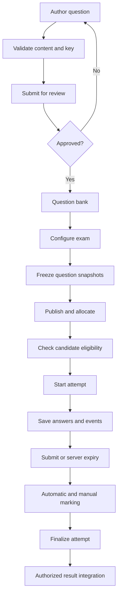
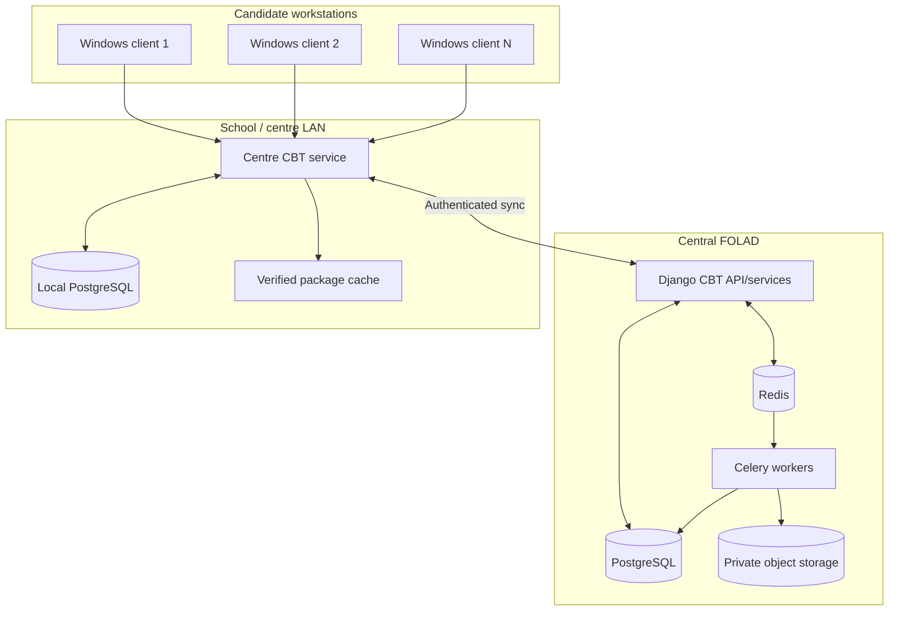

# FOLAD CBT — Architecture

**Status:** Proposed architecture baseline for review  
**Baseline commit:** `baf8248bf1301fb8d93947444b04ca30dd93b2e6`  
**Scope:** Documentation only; no application, model, migration, settings or deployment changes.

## 1. Purpose and operating modes

FOLAD CBT is the examination-delivery capability within FOLAD. It supports school-managed formative/summative examinations, examination-centre deployments and standalone use. It must not duplicate identity, tenancy, academic, student, assessment or result domains.

- **Online:** candidate clients communicate with the central Django CBT API.
- **School LAN:** a centre-local service delivers an authorized exam package and durably records candidate work during WAN outage.
- **Standalone:** one Windows computer runs a local sitting. Any later import remains pending central validation.

The target of 500–2,000 simultaneous candidates is a capacity objective, not a verified performance claim.

## 2. Architecture decisions to preserve

The parent specification [../ARCHITECTURE.md](../ARCHITECTURE.md) remains authoritative.

| Concern | Existing decision | CBT application |
|---|---|---|
| Domain writes | Django + DRF sole system-of-record writer | All central exam, attempt, answer, grading and result mutations use Django services |
| FastAPI | Stateless read/edge service; no direct domain writes | Read analytics/integration edges; enqueue Django-owned work for mutations |
| Database | PostgreSQL; Django ORM owns schema/migrations | Reuse central database and tenant controls |
| Tenant isolation | TenantManager plus PostgreSQL RLS | Organization-scoped CBT rows; never trust client organization IDs |
| Authorization | Central accounts RBAC | Extend permission codes; no parallel role system |
| Async work | Celery/Redis | Imports, package generation, AI processing and reports |
| Files | Provider-neutral S3-compatible storage | Private source documents, media and package artifacts |
| Frontend | Existing Next.js application | Add administration and candidate experiences using established conventions |

FastAPI must not become a second ORM writer. A local centre service may own a separate centre-local operational store, but it cannot write directly to the central domain database.

## 3. Logical components

- **Existing Django CBT domain:** topics, questions, rich-content blocks, options, versions, media, exams, sections, frozen exam-question snapshots, candidate allocations, attempts, answers and attempt events.
- **Administration UI:** authoring/review, exam configuration, allocation, monitoring, marking, analytics and exports.
- **Candidate UI:** eligibility, instructions, attempt launch, navigation, timer, answer persistence, flags, connectivity feedback and submission.
- **Import pipeline:** CSV capability exists; spreadsheet/document ingestion needs staged parsing and validation.
- **Offline/LAN subsystem (new):** centre/device registration, signed packages, local sessions/events, synchronization and monitoring.
- **AI pipeline (new):** source extraction, grounded draft generation, validation and human approval.
- **Integration boundary:** reuse FOLAD student/enrollment/assessment identities and controlled external APIs.

## 4. Domain lifecycle

Published question content and answer-key snapshot must be immutable for that sitting. Delivery and scoring use the published snapshot, not mutable bank content.

## 5. Deployment topology

Online mode uses the central service as authority. LAN mode uses a verified package, local session authorization and durable local event journal; synchronization is through a Django-owned API. Standalone mode follows the same signed-package/event principles but requires central acceptance before a result is trusted.

## 6. Trust boundaries and invariants

1. Browser and desktop clients are untrusted; client timers, timestamps, scoring and proctoring assertions are not authoritative.
2. Server controls eligibility, start/expiry, transitions and final scoring.
3. Candidate payloads never contain answer keys.
4. Organization, school, candidate, exam and attempt relationships are validated server-side.
5. Public UUIDs are identifiers, not authorization.
6. Published snapshots are immutable; corrections follow a controlled version/republication policy.
7. Every mutation is authenticated, permission-checked, tenant-scoped, validated and audited.
8. Offline synchronization is authenticated, sequence-checked, idempotent and replay-resistant.
9. AI-generated questions remain drafts with source provenance until human approval.
10. Operational failure must not silently discard acknowledged answers or finalize unverified offline results.

## 7. Capacity, resilience and operations

The 2,000-candidate objective requires measured tests of login/start bursts, heartbeat rate, answer writes, submission bursts, database connections, worker throughput and media bandwidth. Use bounded polling, short transactions, indexed queries and queue isolation. Heavy imports, parsing, AI inference and reporting must not run on the candidate request path.

A centre service is a critical local dependency: plan UPS/power, durable writes, backup/restore, storage headroom, health monitoring and operator recovery. Use correlation IDs across exam, attempt, device, sync batch and background job. Never log answer keys, tokens or signing secrets.

## 8. Explicit scope boundary

This is a target design, not an implementation report. No code, model, migration, endpoint, workflow, dependency or deployment change is included. Implementation requires review and a separate approved task.
