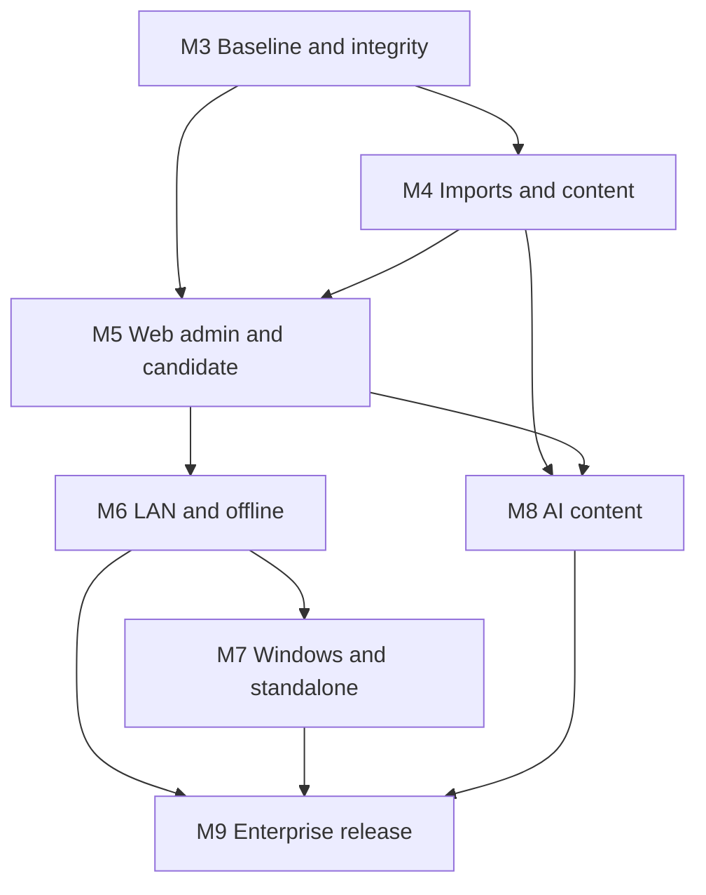

# FOLAD CBT — Implementation Roadmap

**Status:** Proposed sequence for approval  
**Baseline:** `baf8248bf1301fb8d93947444b04ca30dd93b2e6`

## 1. Current baseline

The repository already contains a substantial Django CBT backend: question bank and rich content, exams/sections, frozen exam-question snapshots, candidate allocations, attempts, answers, scoring, invigilation events, analytics and CSV bulk import. Dedicated CBT API and scoring tests exist under `backend/tests/`.

The parent architecture specifies Django as sole domain writer, FastAPI as read/edge service, PostgreSQL with tenant managers/RLS, Redis/Celery for asynchronous work and Next.js for user interfaces.

The repository default branch is `claude/add-file-1kspgf` and does not contain the audited merged CBT tree. This roadmap uses explicit baseline commit `baf8248bf1301fb8d93947444b04ca30dd93b2e6`. Before implementation, reconcile the default branch and select a maintained integration base.

## 2. Delivery principles

1. Stabilize existing domain behavior before adding capabilities.
2. Reuse identity, tenancy, school, student, enrollment, assessment and result models.
3. Keep all central writes in Django services.
4. Complete online candidate delivery before expanding offline scope.
5. Treat LAN/standalone as security-sensitive products with separate acceptance gates.
6. Establish document provenance and human review before AI generation.
7. Performance claims require reproducible measurements.
8. Each phase ships behind tests, documentation and reviewable PRs.

## 3. Milestones

### M3 — Architecture, reconciliation and integrity hardening
Deliverables: accepted architecture/database/API/offline/roadmap/security documents; maintained branch/integration policy; exact route/permission catalogue; verify and correct expiry enforcement, negative-marking policy and concurrency/idempotency gaps; CI for tests, migrations, lint/type/security checks.

Exit: unambiguous baseline; critical lifecycle/scoring defects resolved; PostgreSQL tenant/candidate ownership and answer-key tests pass; CI green.

### M4 — Question content and imports
Deliverables: authoring/rich-content/media validation; XLSX import with preview/mapping/dry-run/errors; DOCX/PDF extraction with page/section provenance; import job retry/idempotency/duplicate detection; accessible rendering of diagrams/equations/media.

Exit: documented format limits and fixtures; hostile/malformed files safely rejected or sandboxed; no unreviewed publication; tenant/RBAC tests pass.

### M5 — Web administration and candidate delivery
Deliverables: CBT dashboard; question bank editor/review/media/import screens; exam builder, sections, marks, timing, rules and allocations; candidate preflight/instructions/attempt workspace/timer/navigation/save/flag/submit; live monitoring, invigilation review, manual marking, results and exports.

Exit: complete end-to-end exam via UI; no answer-key or cross-candidate leakage; reconnect/retry safe; accessibility and supported browser tests pass.

### M6 — LAN and offline service
Deliverables: centre/device registration; signed/versioned packages and revocation; centre service with durable event journal; offline session provisioning; signed idempotent sync and conflict quarantine; operator console, metrics and recovery runbooks.

Exit: no central write bypasses Django; tampering/revocation/invalid event rejected; restart/power-loss preserves acknowledged answers; sync idempotent; pilot passes agreed load/recovery tests.

### M7 — Windows desktop and standalone
Deliverables: signed installer/managed update; candidate kiosk client; encrypted local cache/recovery; centre discovery and diagnostics; single-device standalone profile; enrollment/revocation/support tooling.

Exit: clean install/uninstall/upgrade on supported Windows versions; signing/local data protection verified; restart/disconnect tests pass; standalone import requires central validation.

### M8 — AI content assistance
Deliverables: source ingestion/extraction; source-grounded question generation; page/section evidence and model/prompt tracking; schema/answer-key/ambiguity checks; human review and audit; diagram generation with accessible text/provenance.

Exit: every draft has evidence; unsupported claims flagged; human approval required; evaluation measures correctness, ambiguity, curriculum alignment and bias.

### M9 — Enterprise performance and release
Deliverables: central/LAN tests at 500, 1,000 and 2,000 concurrent profiles; DB/worker tuning; penetration test/threat-model review; backup/restore drills; monitoring/incident/centre runbooks; packaging/version/rollback/support.

Exit: agreed SLO/RPO/RTO met; no unresolved critical/high security issue; restore and operational drills demonstrated.

## 4. Dependencies

M4 and M5 may proceed in parallel only after M3 contracts and critical domain behavior are stable. Do not begin offline/desktop on an unverified attempt lifecycle.

## 5. Release gates

- **A — Domain integrity:** timer, transitions, grading, answer persistence and result integration.
- **B — Security:** tenant isolation, candidate ownership, answer-key secrecy, RBAC and audit.
- **C — Usability:** complete admin/candidate workflow, accessibility and supported devices.
- **D — Offline integrity:** signed packages, durable events, replay protection, sync and recovery.
- **E — Capacity:** measured load, fault tolerance and operations readiness.

Do not bundle unrelated LMS features into CBT releases. Schema, migration, service, desktop framework and external integration changes require separate design and implementation PRs.
