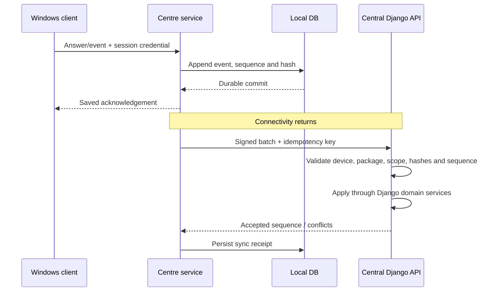

# FOLAD CBT — Offline and LAN Architecture

**Status:** Proposed design; no offline subsystem is implemented by this documentation change.  
**Baseline:** `baf8248bf1301fb8d93947444b04ca30dd93b2e6`

## 1. Goals and modes

Provide reliable exam delivery during internet instability while preserving central control over authorization, eligibility, integrity and final result acceptance.

- **Online:** central service handles candidate sessions.
- **LAN:** centre-local service delivers packages and durably records many candidate sessions.
- **Standalone:** one Windows workstation handles a local sitting.

LAN is the recommended offline mode for a multi-candidate centre. Standalone is not a substitute for a 2,000-seat LAN service.

## 2. Components

**Central control plane:** Django CBT API/domain services, PostgreSQL, Redis/Celery, private object storage, device registry and signing-key metadata.

**Centre data plane:** local CBT service, local PostgreSQL operational store, verified package cache, operator console and monitoring.

**Workstation:** managed Windows candidate client, device/session credentials, kiosk controls and encrypted minimal local cache.

## 3. Provisioning

1. Administrator registers centre server and candidate devices centrally.
2. Device generates a key pair; private key remains protected locally.
3. Exam is published and candidates allocated centrally.
4. Central service builds a versioned package for the approved centre.
5. Package is encrypted, signed, hashed and delivered through authenticated access.
6. Centre verifies signature, hashes, validity, scope and revocation.
7. Operator checks roster, station inventory, clock, storage and server health.
8. Complete any policy-required online preflight before WAN disconnection.

## 4. Candidate session and event capture

Each session is bound to organization, centre, exam/package version, candidate allocation, device, start/expiry policy and attempt rules.

The client writes answer changes to a durable local queue before displaying a saved acknowledgement. The centre service acknowledges only after durable commit. Events are append-only and ordered by per-session sequence. After restart, resume only after validating the session and replaying committed events.

Client timestamps are diagnostic only. Centre service uses a trusted clock and records clock-health status. If drift exceeds policy, block new sessions or require operator escalation.

## 5. Synchronization flow

Rules:
- Unique event ID and monotonic sequence per session.
- Batch includes idempotency key, payload hash, range and device signature.
- Reject conflicting duplicate IDs, missing sequences, invalid signatures, revoked devices and mismatched candidate/exam scope.
- Retry same idempotency key with identical payload.
- Central writes only through Django services.
- Persist local receipt only after central commit confirmation.
- Never overwrite a centrally accepted answer with an older offline value.

## 6. Conflict policy

Default to **single-writer ownership per candidate attempt**: an attempt is centrally active or assigned to one offline session, not simultaneously editable online/offline.

If conflict occurs, preserve both histories, quarantine the batch, do not merge based on client timestamp, route to authorized review, record actor/reason/decision and retain immutable source events.

## 7. Security controls

- Signed package manifest and integrity hashes.
- Authenticated TLS centrally and on managed LAN.
- Device-bound credentials with revocation/rotation.
- Encryption at rest for local DB, cache and temporary files.
- No answer keys in candidate package.
- Package validity and revocation enforcement.
- Kiosk policy and restricted OS account.
- Restrict clipboard, capture, navigation and removable media where OS policy permits; do not claim client-side controls are tamper-proof.
- Code-signed Windows software and managed updates.
- Sync schema/size limits and safe import handling.
- Audit operator actions and all state transitions.
- Do not log answers, tokens, private keys or sensitive payloads unnecessarily.

Offline delivery cannot guarantee resistance to a determined person with physical control of a device. High-stakes use also requires centre controls, invigilation and post-sync integrity checks.

## 8. Failure and recovery

| Failure | Required behavior |
|---|---|
| Workstation restart | Recover centre-acknowledged event journal |
| Centre service restart | Recover local DB; do not reset sequence |
| WAN outage | Continue only within package/session policy |
| Local DB unavailable | Stop acknowledging writes and alert operator |
| Disk near capacity | Alert early; stop new sessions before unsafe failure |
| Device revoked | Reject launch/sync per policy |
| Package expired/revoked | Block launch/continuation per signed policy |
| Duplicate sync retry | Return original idempotent outcome |
| Sequence/hash mismatch | Quarantine; do not advance sequence |
| Central service unavailable | Retain durable unsynced events and retry |
| Power loss | Durable commits, UPS and tested restore |

## 9. Capacity and acceptance

Size from measured candidate count, login/start burst, answer-write rate, event growth, package/media size, DB IOPS, connections, CPU, TLS and recovery requirements. A single centre server is a potential single point of failure; assess standby/recovery options.

Acceptance tests:
- Tampered package/signature blocks launch.
- Candidate cannot access another session.
- Revocation is enforced.
- Restart/power loss preserves acknowledged answers.
- Duplicate sync is idempotent.
- Missing/reordered/modified events are detected.
- Conflicts are quarantined, never silently merged.
- Central accepted state matches validated event history.
- 500–2,000-seat load target meets agreed latency/error thresholds.
- Operator can diagnose package, clock, device, disk, network and sync state.
